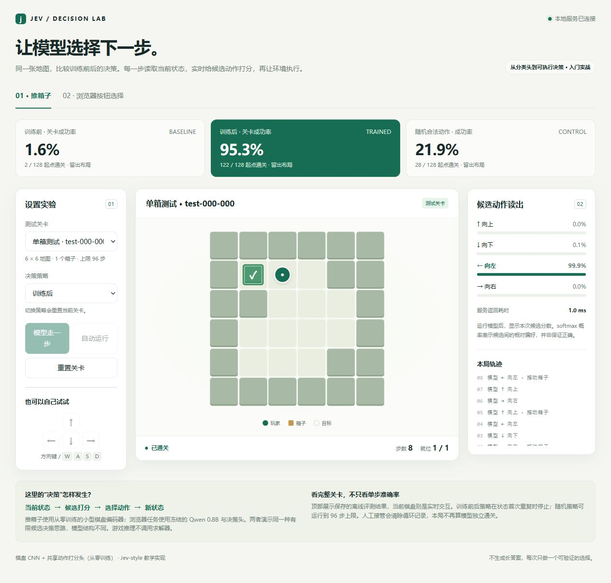

# Jev Decision Teaching

让模型选择下一步：先玩一个会推箱子的小策略，再学习候选打分、训练和页面按钮决策。

这是中文入门实战，附带可运行示例、小型策略权重、训练代码和完整失败记录。采用 Jev-style 候选打分思路，未复现 TypeSafe Jev 的专有训练方法。

## 先玩起来：无需下载大模型

需要 **Python 3.11+、Git**。所有命令在仓库根目录执行；不需要激活虚拟环境或安装本项目为 Python 包。

Windows PowerShell：

```powershell
git clone https://github.com/adenzhou1350/jev-decision-teaching.git
cd jev-decision-teaching
python -m venv .venv
.\.venv\Scripts\python.exe -m pip install -r requirements.txt
.\.venv\Scripts\python.exe -m jev_teaching
```

Linux / macOS：

```bash
git clone https://github.com/adenzhou1350/jev-decision-teaching.git
cd jev-decision-teaching
python3 -m venv .venv
.venv/bin/python -m pip install -r requirements.txt
.venv/bin/python -m jev_teaching
```

打开 **http://127.0.0.1:8765**，选择一个关卡，比较训练前后，点击单步或自动运行，也可以用方向键接管。推箱子策略在 CPU 上运行，每一步均调用真实模型。



遇到安装问题，或想启用页面按钮模型，见 [安装与运行指南](docs/getting-started.md)。本项目已在原生 Windows 上实测，Linux/macOS 的上述入口尚未逐平台验证。

## 接下来学什么

| 你想做什么 | 从这里开始 | 需要什么 |
|---|---|---|
| 读懂最小候选打分与训练 | [第一课：文本决策头](docs/lessons/01-text.md) | Qwen3.5-0.8B 本地快照 |
| 从零训练能玩完整局的模型 | [第二课：推箱子](docs/lessons/02-sokoban.md) | PyTorch；无需语言模型 |
| 让语言模型选择页面按钮 | [第三课：浏览器按钮](docs/lessons/03-browser.md) | 模型依赖与 Qwen 本地快照 |
| 重训、调用服务或排查报错 | [安装与运行指南](docs/getting-started.md) | 按所选课程安装 |
| 核对报告与失败案例 | [实验记录](docs/experiments.md) / [证据目录](artifacts/README.md) | 报告可直接阅读 |

推箱子使用 360,097 参数的棋盘 CNN，从零训练；页面按钮冻结 Qwen3.5-0.8B，只训练 1,024 参数的共享头。两课使用同样的“状态＋候选 → 打分 → 执行”接口，但不是同一个模型。

## 真实效果与边界

以下为一次固定种子的教学实验，全部失败均保留。游戏测闭环通关率，按钮测单步完成率。

| 场景 | 随机初始化 | 简单基线 | 训练后 |
|---|---:|---:|---:|
| 单箱：32 个未见布局、128 个起点 | 2/128 | 随机合法动作 28/128 | **122/128 · 95.3%** |
| 双箱：12 个布局、48 个起点 | 0/48 | 随机合法动作 4/48 | **25/48 · 52.1%** |
| 页面按钮：48 条留出表达 | 11/48 | 词面匹配 24/48 | **34/48 · 70.8%** |
| 页面按钮：24 条否定/引用挑战 | 6/24 | 词面匹配 13/24 | **18/24 · 75.0%** |

同一布局的多个起点有关联；双箱表现已显示分布变化会明显降低成功率。浏览器使用六种合成本地页面的文字，没有截图理解或跨站多步导航；随机头也不代表原始 Qwen 的生成能力。完整基线、误触发、计时范围见 [实验记录](docs/experiments.md)。

## 文件放在哪里

```text
jev_teaching/   训练、评测、服务代码；web/ 是演示页面
docs/          三节课、安装指南、实验记录与截图
tests/         自动化测试
artifacts/     随附策略、报告与复核证据，不含 Qwen 底座
runs/          你自己的训练结果（运行后生成，不入库）
```

代码入口统一为 `python -m jev_teaching`；具体工具用 `python -m jev_teaching.<工具名>`。旧版根目录脚本已移入包中，更新仓库后请使用文档中的新命令。

参考项目：[NanoJev](https://github.com/TianyuCodings/NanoJev)、[Open-Jev](https://github.com/Zefan-Cai/Open-Jev)。
