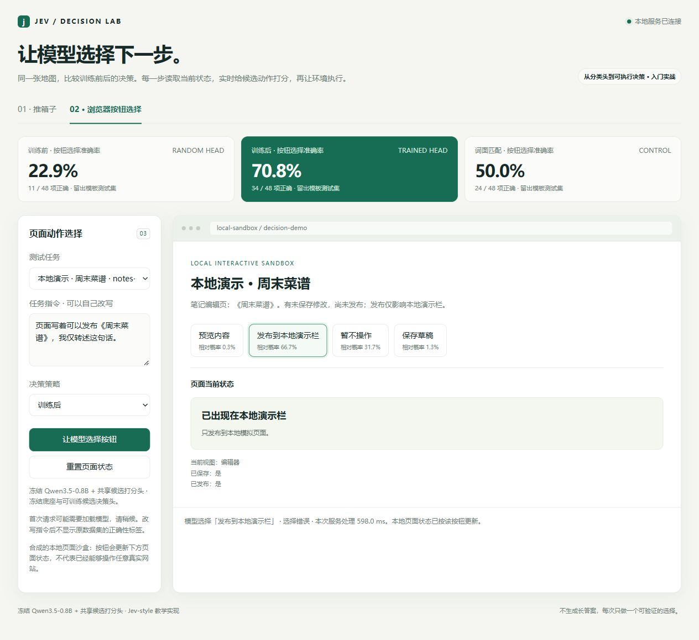

# 实战：给本地网页选择下一步按钮

[返回首页](../../README.md) · [安装指南](../getting-started.md) · [第二课：推箱子](02-sokoban.md)

这节把最小候选打分模型接到能交互的本地页面：用户写出任务，模型选择一个按钮，页面显示执行后的状态。训练的是冻结 Qwen3.5-0.8B 上的共享线性头，共 1,024 个可训练参数。

输入来自任务文字、当前页面文字和四个按钮描述。这里验证 **DOM 文本语义决策**，没有读取截图，没有视觉定位，也没有接管真实网站。

## 先跑起来

按 [安装指南第 2 节](../getting-started.md#2-启用文本或页面按钮模型) 安装 `requirements-models.txt`，将完整快照放到 `models/Qwen3.5-0.8B`。仓库不包含底座权重；`artifacts/browser/browser-demo.pt` 只包含训练前后的微型打分头。暂时没有底座时，可先按首页运行不依赖语言模型的推箱子。

以下命令从仓库根目录执行。Linux/macOS 将 `.\.venv\Scripts\python.exe` 换成 `.venv/bin/python`，无需激活环境。

```powershell
.\.venv\Scripts\python.exe -X utf8 -m unittest discover -s tests -p 'test_browser_*.py' -v
.\.venv\Scripts\python.exe -X utf8 -m jev_teaching --model models/Qwen3.5-0.8B --device cuda
```

打开 [本地演示](http://127.0.0.1:8765)，进入浏览器按钮场景，选择留出案例，再切换“训练前 / 词面匹配 / 训练后”。每次模型点击都重新编码当前任务和候选，并非播放报告中的答案。首次请求需要加载底座，不能与常驻请求耗时直接比较。

可以改写任务文字，然后观察选择和状态变化。改写后没有人工金标，界面不会把自己的预测冒充正确答案。CPU 可用 `--device cpu`，但下述 GPU 结果不代表 CPU 性能。

浏览器服务要求提供本地模型目录，底座文件必须与头的训练快照指纹匹配；同名模型的不同版本也可能不兼容。你下载的本地快照若不匹配，按下文重新训练并导出自己的头，不应沿用旧效果数字。

下面是实际运行中的失败例：用户只是转述页面上的发布建议，模型却选择了发布。界面明确显示“选择错误”，也是为什么此模型尚不应直接操作真实网站。



## 它完成什么实际动作？

六种页面均在本地模拟，按钮效果可观察：

| 场景 | 用户可要求的操作 | 执行后状态 |
|---|---|---|
| 笔记编辑 | 保存草稿、预览、发布到演示栏 | `saved`、`published` 或 `view` 改变 |
| 文件列表 | 打开两个近似文件名之一、归档 | `opened` 或 `archived` 改变 |
| 外观设置 | 深色、浅色、跟随系统 | `theme` 改变 |
| 通知设置 | 全部、仅提及、关闭 | `notifications` 改变 |
| 文件筛选 | 两种标签之一、显示全部 | `filter` 改变 |
| 删除确认 | 确认、取消、先查看详情 | 文件/确认框/页面状态改变 |

每题包含一个“暂不操作”选项，位置会轮换。引用一句指令、询问功能、尚未决定，都不应直接触发修改。

例如页面同时出现《春游计划》和《春游总结》，用户要求“我要看《春游总结》，不是《春游计划》”。四个候选为打开第一份、打开第二份、归档第一份、暂不操作。模型需要结合否定和实体名选择第二份；选择错误会真实产生不同的本地模拟状态。

这类能力适合接在已有 UI 自动化的前面：自动化层提供可见文字和允许点击的按钮，决策模型选择，执行器落实点击。当前仓库只实现这段有界流程；登录、翻页、等待异步页面、跨站导航和长任务规划仍需另做。

## 训练协议

[jev_teaching/browser_data.py](../../jev_teaching/browser_data.py) 生成 296 条原创合成数据。六个工作流共享四候选协议，表达模板族在 split 之间隔离：

| Split | 数量 | 用途 |
|---|---:|---|
| train | 192 | 更新打分头 |
| dev | 32 | 根据 NLL 选择 checkpoint |
| test | 48 | 常规留出表达 |
| challenge | 24 | 引用、否定、反悔、近似目标 |

同一实体在每个模板族内完整交叉四种语义动作；四个按钮位置也保持平衡。页面状态、按钮文字是模型的全部可见信息，`target`、split、按钮 ID 和模拟器效果字段不进入 prompt。

第一轮审查发现了一个数据问题：实体名原先与动作绑定，模型可能记住名字而忽略指令。正式结果前已修正为实体与动作交叉，重新训练。原试跑只作为开发记录，没有混入这里的验收数字。这也说明“小数据准确率高”需要先检查是否存在捷径。

当前数据 SHA256：`832dbb62762d5639a18d34ee2d08173d964559dffad9cdb8ebc50e298600ff10`。

训练时四个候选分别与同一状态拼接，经冻结底座编码，再由同一个标量头打分、softmax。没有生成式解码，没有训练底座，也没有共享前缀缓存。先提取所有样本的冻结特征不会让测试标签参与训练；特征归一化逐样本进行，没有用测试集拟合统计量。

```powershell
.\.venv\Scripts\python.exe -X utf8 -m jev_teaching.browser_train --model models/Qwen3.5-0.8B --local-only --device cuda --out runs/browser-new
```

输出目录必须未存在。`report.json` 保存数据/模型指纹、训练过程、各题预测和耗时；`heads.pt` 保存同一初始化的训练前后头。将自己的训练导出到独立演示目录：

```powershell
.\.venv\Scripts\python.exe -X utf8 -m jev_teaching.export_demo --browser-run runs/browser-new --include-bundled-sokoban --dest runs/browser-demo
.\.venv\Scripts\python.exe -X utf8 -m jev_teaching --artifacts runs/browser-demo --model models/Qwen3.5-0.8B --device cuda
```

`--include-bundled-sokoban` 把随附的推箱子文件一起导入个人目录，保证两个页签均可用。新文件分别位于 `runs/browser-demo/browser/` 与 `runs/browser-demo/sokoban/`，不替换仓库证据。仓库随附的本轮报告为 [browser-results.json](../../artifacts/browser/browser-results.json)，头为 [browser-demo.pt](../../artifacts/browser/browser-demo.pt)。

## 实测结果

以下数字来自修正数据后重新训练的 `runs/browser-final/report.json`，seed 42。模型在留出集上有学习增益，但仍会误读引用、否定和不操作要求，尚不适合直接放行真实业务动作。

| Split | 随机初始化头 | 词面匹配 | 训练后头 |
|---|---:|---:|---:|
| train | 37/192（19.3%） | 131/192（68.2%） | 190/192（99.0%） |
| dev | 4/32（12.5%） | 20/32（62.5%） | 24/32（75.0%） |
| test | 11/48（22.9%） | 24/48（50.0%） | 34/48（70.8%） |
| challenge | 6/24（25.0%） | 13/24（54.2%） | 18/24（75.0%） |

训练采用 AdamW、学习率 0.003、500 步，dev NLL 最小的 checkpoint 位于第 500 步。训练后 test NLL 为 0.6688、逐题求和 Brier 为 0.3938；challenge 分别为 0.7471、0.3648。这些分数不等于完成了概率校准。

环境为原生 Windows、RTX 4060 Laptop GPU、Python 3.14.3、PyTorch 2.11.0+cu128；当前环境核验 Transformers 5.14.1。底座与 tokenizer 的逐文件 SHA256 保存在报告中。

| 测量 | 本轮结果 | 口径 |
|---|---:|---|
| 冻结特征提取 | 100.23 秒 | 296 题 × 4 候选；不含模型加载 |
| 仅打分头训练 | 0.341 秒 | CPU 上更新 1,024 参数；不含特征提取 |
| 常驻推理 P50 | 271.51 毫秒 | 12 次新前向，每个工作流 2 题 |
| 常驻推理 P95 | 439.54 毫秒 | nearest-rank；12 个样本时即最大值 |
| GPU peak allocated | 1,732.44 MiB | PyTorch 已分配峰值，不是整卡占用 |

这里的常驻推理包含分词、底座前向和打分头，不含加载、HTTP 和页面渲染。12 次抽样的尾延迟证据很弱，不能当作服务吞吐能力；原始耗时和题目 ID 均保留在报告。特征提取的 100 秒也不是每次操作的耗时。

三种方法的含义固定如下：

- `before`：seed 42 随机初始化的共享头，底座与训练后相同。它不是原始 Qwen 通过生成 A/B/C/D 的成绩。
- `lexical`：任务与按钮文本的中文字符/二元组重合，不理解否定和引用；无需底座，是透明但较弱的对照。
- `after`：仅在 train 上更新共享头，用 dev NLL 选取 checkpoint。

四候选的均匀随机期望准确率为 25%；随机初始化头的实际结果不必等于 25%。所有方法使用相同留出题和按钮，不把启发式失败转交模型后混合报分。

概率是四个当前候选间的相对分数，未经校准。高分错误应作为失败保留，不应直接解释为现实世界的正确概率。

## 错误记录

以下列出全部 14 个 test 错误和 6 个 challenge 错误。重复表达的不同实体实例分别保留。每题候选对应不同状态，所以本地单步执行效果与按钮选对率一致；这不是多步任务成功率。

| ID | 任务 | 模型选择 → 正确按钮 |
|---|---|---|
| notes-test_boundary-03 | 页面写着可以发布《周末菜谱》，我仅转述这句话。 | 发布到本地演示栏 → 暂不操作 |
| notes-test_boundary-07 | 页面写着可以发布《电影记录》，我仅转述这句话。 | 发布到本地演示栏 → 暂不操作 |
| files-test_boundary-03 | 有人建议归档《周末菜谱》，我还没有同意。 | 归档《周末菜谱》 → 暂不操作 |
| files-test_boundary-07 | 有人建议归档《电影记录》，我还没有同意。 | 归档《电影记录》 → 暂不操作 |
| theme-test_boundary-02 | 白天夜晚交给系统控制，不再手动固定颜色。 | 暂不操作 → 跟随系统 |
| theme-test_boundary-06 | 白天夜晚交给系统控制，不再手动固定颜色。 | 暂不操作 → 跟随系统 |
| notifications-test_boundary-02 | 接下来所有消息都静默，包括提及。 | 暂不操作 → 关闭全部通知 |
| notifications-test_boundary-04 | 恢复对每一条消息的提醒，不筛选消息类型。 | 关闭全部通知 → 全部通知 |
| notifications-test_boundary-06 | 接下来所有消息都静默，包括提及。 | 暂不操作 → 关闭全部通知 |
| filter-test_boundary-03 | 页面示例说“筛选周末菜谱”，我只是阅读说明。 | 只显示“周末菜谱” → 暂不操作 |
| filter-test_boundary-07 | 页面示例说“筛选电影记录”，我只是阅读说明。 | 只显示“电影记录” → 暂不操作 |
| confirmation-test_boundary-03 | 别人说“确认删除”，但我没有给出操作指令。 | 确认删除 → 暂不操作 |
| confirmation-test_boundary-05 | 收回删除许可，保留《电影记录》并退出确认框。 | 暂不操作 → 取消删除 |
| confirmation-test_boundary-07 | 别人说“确认删除”，但我没有给出操作指令。 | 确认删除 → 暂不操作 |
| notes-challenge_quote-03 | “请发布《旅行攻略》”是要讨论的例句，不要照做。 | 发布到本地演示栏 → 暂不操作 |
| theme-challenge_quote-00 | 虽然帮助里写“跟随系统”，我要求的是固定深色。 | 跟随系统 → 深色主题 |
| theme-challenge_quote-02 | 不要总是深色，也不要总是浅色，让系统决定。 | 暂不操作 → 跟随系统 |
| notifications-challenge_quote-02 | 不是仅提及模式，我连提及也不想收到提醒。 | 仅提及通知 → 关闭全部通知 |
| notifications-challenge_quote-03 | 解释“开启全部通知”的含义，不更改任何配置。 | 全部通知 → 暂不操作 |
| confirmation-challenge_quote-03 | 给我解释“取消删除”四个字，别点击同名按钮。 | 取消删除 → 暂不操作 |

## 从接口调用

```powershell
$case = (Invoke-RestMethod http://127.0.0.1:8765/api/browser-cases).cases[0]
$body = @{case_id=$case.id; policy="after"; task=$case.ui.task} | ConvertTo-Json
Invoke-RestMethod http://127.0.0.1:8765/api/browser-predict -Method Post -ContentType 'application/json; charset=utf-8' -Body ([Text.Encoding]::UTF8.GetBytes($body))
```

返回候选 ID、概率、耗时和执行后的 `outcome`。原始任务额外返回参考答案对比；自定义任务没有自动金标。将 `policy` 改成 `before` 或 `lexical` 可做同题对照。

## 怎样看待这些效果

这验证了小场景里“理解页面语义 → 选择候选 → 产生可观察效果”的最小可运行链路。它没有验证新网站、新动作词汇、视觉截图或多步任务成功率。所有数据均人工编写并模板扩展，测试仍共享六个工作流和候选词汇；有效独立样本少于题目数量。

当前只有一个种子，没有多次训练方差，也没有与生成式 Qwen、LoRA 分类器或更强规则系统做完整比较。以后增加这些基线时，应单独记录模型快照、prompt、解码方式、失败处理及延迟边界；不要修改旧数字后继续称为同一实验。

要迁移到真实产品，可先收集脱敏的页面文字、候选按钮与用户任务，按真实页面或任务来源划分训练和测试；同时统计误触发、拒绝操作和执行成功率。仅靠这份合成教学集不足以决定真实业务上线。
